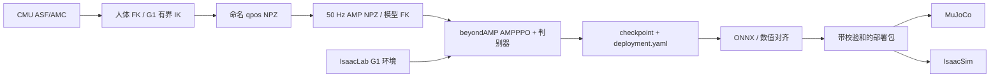

# 设计与当前边界

算法直接依赖锁定版本 beyondAMP 的 `AMPPPO`、`ActorCritic` 和 `AMPDiscriminator`。本工程实现 runner、环境适配、数据整理与部署接口，不通过 `eval()` 动态解析配置类。

## 首个任务

- G1 原版 29 DoF，`g1_29dof`，不混用 `g1_29dof_rev_1_0`。
- 平地速度跟踪 + AMP 样式奖励。粗糙地形、Mimic、实机、ONNX 循环网络不在当前实现范围。
- 策略观测 96 维：基座角速度 3、投影重力 3、速度指令 3、相对默认关节角 29、关节速度 29、上一动作 29。角速度尺度 0.2，关节速度尺度 0.05。先 clip 再 scale。
- critic 99 维，在策略观测前加基座线速度 3。
- AMP 单帧特征 58 维：`q - q_default`、`0.05 * dq`。判别器输入相邻两帧，共 116 维。专家与在线特征按名称重排，保持完全一致。
- 可选 `amp_root_velocity=true` 在 AMP 特征末尾追加根部机体系线速度 3 维（m/s，不缩放），成为单帧 61 维 / 判别器输入 122 维。它帮助区分原地站立与前进，专家采用命名 root 的质心世界速度旋转到 actor frame；GPU 预检验证 RSI 后在线 AMP 特征与所抽专家帧一致。策略/critic 观测和部署接口不变。
- 当前不用 actor empirical normalization 或 AMP running normalizer，避免训练/导出隐含统计量不一致。数值尺度由固定观测契约定义；这也是需正式训练验证的基线选择。
- 物理步长 0.005 s，decimation 4，策略频率 50 Hz。动作 clip ±12，目标角 `q_default + 0.25 * action`。显式 PD 每个物理子步计算，扭矩按关节限值截断。

## 训练与终止状态

IsaacLab step 会自动 reset。`TerminalAMPEnv._reset_idx()` 在 reset 前捕获终止 AMP 和 critic 特征，供 runner 形成正确的 `(s_t, s_terminal)`；下一次在线观测使用 reset 后的状态。读取返回的 policy/critic 缓存，不重复推进 ObservationManager 的历史或噪声。

超时 bootstrap 使用捕获的终止 critic 值；物理跌倒不 bootstrap。IsaacLab 奖励按 dt 积分，适配器除以控制 dt 后再与 AMP 奖励混合，避免一个奖励为积分、另一个为速率。

checkpoint 保存已完成的迭代数、模型、判别器、优化器、学习率、replay buffer、随机数、数据 SHA256 与部署契约。更改数据、契约或训练参数时拒绝无提示恢复。环境的完整物理状态不保存。

可选 `reference_state_initialization` 指定 reset 时使用参考动作状态的概率。关节按部署顺序排列，根部采用命名 root 的高度、朝向和速度；环境保持自身 XY，并将参考朝向、世界线速度和角速度一起旋转到随机 reset 朝向。配置 `train_g1_rsi.json` 的概率为 0.8，保留 20% 默认站立起步。仅用于训练；部署仍从模型默认姿态启动。

训练指标使用 reset 前的终止速度、指令和回合长度，避免自动 reset 后的零速度或零时长混入完成回合统计。评测报告同时给出平均实际速度与 RMSE，识别原地站立而没有跟随指令的策略。

## 部署契约

`deployment.yaml` 保存关节名称与顺序、静止角、增益、扭矩上限、armature、动作缩放、观测次序与尺度、频率、坐标约定、碰撞设置及资产树指纹。

四元数 WXYZ；角速度在 root actor body frame 表达。线速度参考点是 root rigid-body 质心，在 actor frame 表达，与 IsaacLab 2.1 的 `root_lin_vel_b` 一致。MuJoCo 使用 `mj_objectVelocity(..., mjOBJ_BODY, ..., local=0)` 后旋转到 actor frame。BODY 与 XBODY 的线速度参考点不同，不能随意互换。

原生 MuJoCo 通过名称匹配 qpos/qvel/actuator，不假定 XML 顺序等于训练动作顺序。只接受单位 gear、无激活动力学的直接扭矩 motor。ONNX 是确定性 actor；随机探索噪声和 critic 不导出。导出做 32 组输入的 PyTorch / ONNX 对比，并绑定 checkpoint 和策略的 SHA256。

Isaac 侧 URDF 导入使用 explicit `IdealPDActuator`，MuJoCo 去除 XML 旧 passive damping/friction 并应用导出增益。禁用自碰撞、统一标称地面摩擦。`amp-lab model-audit` 已实现源 URDF 固定链接合并后的质量、COM、惯量、零位姿原点和关节轴比较；当前 G1 的两种源模型仍有约 3 g 总质量差。PhysX 导入结果及接触求解器仍需 GPU 实际审计，资产同源不意味着动力学完全相同。

## 验证层次

单元测试验证关节映射、坐标旋转、clip/scale、历史、FK 速度、命名对齐、校验和、算法更新、恢复及 ONNX 数值一致性。CPU G1 smoke 验证真实数据贯穿工程。GPU preflight 验证 Isaac 启动、观测一致性和有限步 rollout。稳定行走、收敛曲线和 sim-to-sim 必须由正式实验确认。
