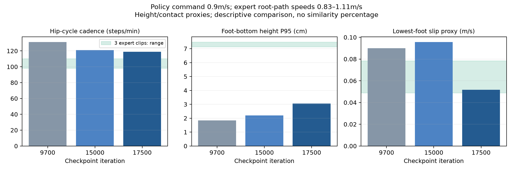

# AMP 长程中期比较与动作风格诊断

2026-10-23；保持原4096环境、seed42和速度奖励配置，训练总目标20000次。9700候选与其归档未被覆盖；15000和17500是独立评测产物。

## 行走效果确有改善

固定指令0.6m/s、20秒；MuJoCo沿用训练旁路CPU watcher结果。Isaac15000为新执行的24环境矩阵中初始朝向0的直行项目；9700为此前单环境结果。

| 权重 | MuJoCo速度RMSE m/s | MuJoCo偏航RMSE rad/s | Isaac速度RMSE m/s | Isaac偏航RMSE rad/s |
| --- | ---: | ---: | ---: | ---: |
| 9700 | 0.020916 | 0.121386 | 0.018256 | 0.117710 |
| 15000 | 0.015357 | 0.064867 | 0.014552 | 0.048651 |
| 17500 | 0.016486 | 0.051089 | 尚未执行 | 尚未执行 |

15000新执行两个模拟器各24项固定指令/初始朝向矩阵，均20秒未跌倒。MuJoCo矩阵最大速度/偏航RMSE为0.039212/0.103390；Isaac为0.035483/0.069011。它优于早期策略的指令跟踪，但尚未作为正式示例替换9700，等待最终20000比较与材料整理。

15000 checkpoint SHA256：`5d794cf2bf0c569199a1dcebe1e050bef8108b6e6047425e4f006cb12c122318`。
ONNX SHA256：`a88eb979acbfcbabdc42350d58d964469d5258b59268f668432161ae623fe709`。
部署契约与9700相同，指纹 `206aa667e97e53ee366e545f6afe2aa3c522b3e57a75675720bf24f6a4067aa1`。

## 风格已有进步，仍有低抬脚差距

新增 `scripts/compare_gait.py`，对匹配专家数据和实际MuJoCo策略轨迹使用同一模型/脚底碰撞球定义。
每个策略分别执行0.6和0.9m/s、20秒；排除策略最初2秒，参考保留原片段。以下为0.9m/s结果：

| 指标 | 9700 | 15000 | 17500 | 三段专家范围 |
| --- | ---: | ---: | ---: | ---: |
| 髋关节周期估计步频，步/分钟 | 131.28 | 120.95 | 118.85 | 98.36–110.18 |
| 双脚分别计算高度P95后取均值，cm | 1.85 | 2.20 | 3.06 | 7.15–7.48 |
| 最低支撑脚底滑动代理均值，m/s | 0.08985 | 0.09570 | 0.05176 | 0.04893–0.07846 |



17500的0.6m/s估计步频为111.11步/分钟、高度P95为3.22cm、滑动代理均值0.04085m/s。
这些量说明后期策略节奏放慢、抬脚增加，0.9m/s滑动代理相比9700降低约42%；不能据此认定每个指标单调改善或已经充分模仿参考。

重要定义与解释：

- **高度P95不是每次摆动峰值**。专家完整摆动峰值均值约7.82–8.29cm，与表中的P95分开记录。
- 步频来自左右髋俯仰角的周期峰间隔（显著度至少0.05rad且至少幅值范围20%，峰间隔至少0.25秒），每周期按两步计算。完整周期数随报告保存，专家片段短，估计较粗。
- 接触事件另用高度1.5cm进入、3.5cm离开及0.06秒持续阈值。策略抬脚低时该代理无法检测完整周期，报告会保留null，不能理解为机器人没有交替迈步。髋周期估计用于补充描述，不伪造落脚事件或步幅。
- 滑动代理沿用动作质量审计：以脚底最低高度和1cm迟滞选择一只支撑脚，底部低于2.5cm时测该最低碰撞球底部点的水平速度，包含角速度和COM偏移。它不是力传感器测得的真实接触滑动。另一项“所有近地脚点速度”也完整保留，不能与此列混用。
- 专家根部路径速度约0.83–1.11m/s；0.9m/s更接近这一区间，但仍非严格逐速度匹配。原始机体系前进均速略低，两者定义不同。
- 使用运动学参考对比动力学策略；没有逐帧相位对齐、独立风格分类器或可校准的相似度百分比。AMP奖励上升只能作为辅助信号。

## 复现入口

先按quickstart安装CPU推理依赖及分析依赖 `pip install -e '.[analysis]'`，再对已取得的完整策略包执行：

```bash
.venv/bin/python scripts/compare_gait.py outputs/release_candidate_9700/bundle \
  --references outputs/release_candidate_9700/data/00_candidate_amp.npz \
    outputs/release_candidate_9700/data/01_candidate_amp.npz \
    outputs/release_candidate_9700/data/02_candidate_amp.npz \
  --speeds 0.6 0.9 --seconds 20 --warmup 2 --output outputs/my_gait.json
```

报告同时保存策略/部署/参考/轨迹哈希和真实轨迹NPZ。多个报告可画对照图：

```bash
.venv/bin/python scripts/plot_gait.py outputs/my_gait.json --labels 9700 \
  --speed 0.9 --output outputs/my_gait.png
```

本轮原始结果在本地 `outputs/progress_18000/`：`gait_9700_v3.json`、`gait_15000_v3.json`、`gait_17500_v3.json`、对应未修改的rollout NPZ，以及 `mujoco_matrix_15000.json`、`isaac_matrix_15000.json`。v3是最终的峰间隔步频定义；v1/v2探索报告保留但不用于上述表格。

开发机15000矩阵在 `/root/amp-lab/outputs/comparison_15000/isaac_matrix.json`。训练结束后的最终20000比较安排在独立后台工作流，等待训练成功退出标记和CPU watcher最终导出后再执行Isaac/MuJoCo矩阵、步态诊断与持久备份；启动记录见项目状态。启动不等于已完成评测。

下一轮的具体目标应是提高摆动脚离地高度、减少滑步，同时保留速度与稳定性。可先比较已准备但尚未训练的65%时间速度专家数据，验证速度分布匹配是否有帮助；本轮不改动训练数据、AMP权重或奖励，也不启动新的付费资源。
