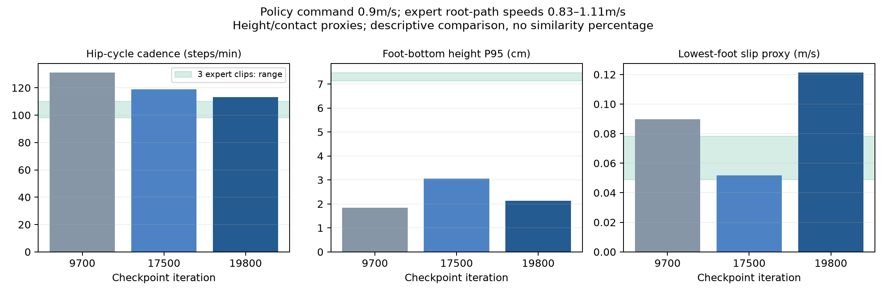

# 19800次诊断与下一轮风格对照

2026-10-23。用户要求取消20000次复查，以19800次结果指导优化，并尽快继续利用GPU训练。

## 已执行的19800次测试

同ONNX、指令0.6m/s、两个模拟器各独立20秒，均完成且未跌倒。没有执行19800次24项矩阵，不把此前9700/15000矩阵结果移作这份权重的证据。

| 指标 | MuJoCo | Isaac |
| --- | ---: | ---: |
| 平均前进速度 m/s | 0.593038 | 0.600283 |
| XY速度RMSE m/s | 0.015949 | 0.012114 |
| 偏航角速度RMSE rad/s | 0.045164 | 0.035596 |

checkpoint SHA256：`24d2337c5f3f2d34fabd29663bffc92e0885551825ea7596eb01015aad531132`。
ONNX SHA256：`29fbddf73b553c7ea3c747bd83aaaac7f7b84aa386a1180be32193caf64dc2c3`。
部署契约沿用既有指纹 `206aa667e97e53ee366e545f6afe2aa3c522b3e57a75675720bf24f6a4067aa1`。

0.9m/s步态对比，使用[中期报告](g1_amp_18000.md)中的同一测量定义：

| 指标 | 17500次 | 19800次 |
| --- | ---: | ---: |
| 髋周期估计步频，步/分钟 | 118.85 | 113.21 |
| 双脚高度P95均值，cm | 3.06 | 2.13 |
| 最低支撑脚滑动代理均值，m/s | 0.05176 | 0.12144 |



19800次的0.6m/s高度P95均值2.82cm，滑动代理均值0.03896m/s。高速度项目的风格指标退步，说明迭代数增加、速度误差降低和AMP奖励升高不保证自然步态同步改善。该指标是高度推断的支撑和点速度，不是力测量。

补充冻结19800判别器的离线诊断：专家训练439个相邻帧对、同人未训练片段07_06共173对，与两个确定性策略各999个帧对比较，固定判别器的专家/策略ROC-AUC均为1.0。均值仍只有专家+0.0450、策略约-0.0361/-0.0331；**输出数值接近零不代表无法区分**。AUC不是相似度百分比，且存在速度分布、确定性推理对随机训练策略、相邻样本相关等混杂，没有独立风格分类器或跨人验证。

根部高度诊断也有差距：专家平均0.725–0.734m，标准差约1.76–2.15cm；19800策略平均约0.748–0.750m，标准差约0.07–0.22cm。说明参考有更明显的上下起伏；不据此直接添加强制上下跳动奖励。

## 当前优化假设与正在运行的对照

现有专家机体系平均前进速度0.815/1.061/1.091m/s，训练指令为0.3–0.9m/s；主要任务均速约0.57m/s。当前AMP输入为29关节相对位置、29关节速度乘0.05、3维根部线速度；没有显式脚底高度、足端位置/速度或根部高度。

这些差距尚未经过因果验证。先进行两组已有条件能直接运行的实验，不同时改网络、数据、奖励：

| 实验 | 相对原配置的变化 | 输出目录 |
| --- | --- | --- |
| slow065 | 只更换已准备的65%时间速度专家数据，机体系均速0.529–0.709m/s | `outputs/gpu_slow065_4096_seed42` |
| style_x2 | 原数据，AMP奖励系数1→2 | `outputs/gpu_style_x2_4096_seed42` |

两组均4096环境、seed42、3000次更新、原速度配置、80%参考初始化，从随机初始化重新训练。slow065的参考初始化也使用重采样后的状态；这是整个数据集变化，不宣称只影响判别器。保持严格恢复契约，没有把变更后的配置/数据冒充19800次的断点续训。旧19800权重单独保留。

style_x2配置：`configs/train_g1_style_x2.json`，相对 `train_g1_rsi_speed.json` 仅 `amp_reward_coef` 为2.0。**该组原始AMP奖励会按系数翻倍，不能跨组直接比较其数值**；若看日志，应除以系数，最终仍以真实步态与行走测试为准。

```bash
/workspace/isaaclab/isaaclab.sh -p scripts/train.py --headless --num-envs 4096 \
  --iterations 3000 --seed 42 --config configs/train_g1_rsi_speed.json \
  --motions data/processed/cmu_walk_slow065_v1/train/*/candidate_amp.npz \
  --output outputs/gpu_slow065_4096_seed42

/workspace/isaaclab/isaaclab.sh -p scripts/train.py --headless --num-envs 4096 \
  --iterations 3000 --seed 42 --config configs/train_g1_style_x2.json \
  --motions data/processed/cmu_walk_candidate_v1/train/*/candidate_amp.npz \
  --output outputs/gpu_style_x2_4096_seed42
```

CPU watcher各评测每100次checkpoint的0.6m/s直行；每500次权重读回核验后备份至 `/personal/beyondamp/2026-10-23/style_ablations/`。另外安排1000和3000次的0.6/0.9m/s步态诊断，对照相同原始专家数据，明确该评测参考与slow065训练参考不同。矩阵/Isaac复测留给实际有改善的候选，不为每份中间权重重复运行。

后续选择同时看未跌倒、速度/偏航误差、抬脚和滑步，避免用更差的风格换更小的任务误差。首轮3000次只作筛选；无改善时再考虑显式足端AMP特征或温和的摆动/滑步项，不能提前宣称有效，也不盲目增加原配置迭代数。

## 存储与本轮状态

- 本地19800证据：`outputs/progress_19800/`；约815KB的ONNX/部署/训练配置/导出/双环境/步态归档已下载并核验。诊断脚本与判别器JSON也保留在该目录。
- 持久证据：`/personal/beyondamp/2026-10-23/evidence_19800_small.tar.gz`，814,957 bytes，SHA `ca820911f00f3a52fa5bd8e09b9fb894b880183ebe7fbb27c6d5dc0f370f5ab3`。
- 持久19800权重：`/personal/beyondamp/2026-10-23/comparison_19800/model_19800.pt`，SHA见上。
- 原长训练已成功完成20000次，权重已持久备份；按用户要求终止最终评测工作流和原CPU watcher，没有对20000次执行额外测试。
- 两组新训练已实际到144/127次，采样GPU96%、10910MiB、244.01W；两组约1.89秒/次，首个1000次里程碑约剩27分钟，3000次约剩90分钟。时间是该次采样的估计，不是训练成功或公开发布承诺。
- 9700匹配候选及其归档没有覆盖，19800仅用于本轮优化参考；尚未创建公开Release。

## 停机后恢复与中间结果（2026-10-24）

用户在额度耗尽后关闭开发机，现已重新开机并授权继续。重连时GPU空闲、无残留训练。slow065日志到1175、style_x2到1156次，最近完整权重均为1100次。两组均从1100恢复至**总计3000次**，未改配置、数据、4096环境或seed42。恢复包含网络、判别器、优化器、replay与RNG；模拟器状态重新初始化，并非逐物理步精确续接。未保存的75/56次更新不计为恢复进度，旧目录和日志保留。

1100次CPU MuJoCo独立20秒、指令0.6m/s的结果：

| 对照 | 平均前进速度 m/s | XY速度RMSE m/s | 偏航RMSE rad/s | 跌倒 |
| --- | ---: | ---: | ---: | --- |
| slow065 | 0.59772 | 0.03439 | 0.29846 | 无 |
| style_x2 | 0.57933 | 0.05020 | 0.39509 | 无 |

两份权重尚未执行Isaac验证。style_x2此时偏航误差仍超过现有发布门槛0.3rad/s；没有据此替换已有候选。

已完成的1000次步态评测，同一MuJoCo定义、剔除前2秒，均20秒未跌倒：

| 对照 | 指令 m/s | 双脚高度P95均值 cm | 支撑脚滑动代理均值 m/s | 髋峰间隔估计步频 步/分 |
| --- | ---: | ---: | ---: | ---: |
| slow065 | 0.6 | 1.219 | 0.14963 | 184.94 |
| slow065 | 0.9 | 1.947 | 0.17252 | 190.53 |
| style_x2 | 0.6 | 1.159 | 0.57783 | 195.35 |
| style_x2 | 0.9 | 1.869 | 0.07818 | 203.99 |

两组仍低抬脚且髋周期偏快，尚无风格改善结论。特别是style_x2的0.6m/s滑动代理较大，不能仅凭稳定前进或奖励提高判断优化有效。不同训练预算不作因果优劣结论，先完成原定3000次筛选。

恢复输出：`outputs/gpu_slow065_4096_seed42_resumed_20261024` 和 `outputs/gpu_style_x2_4096_seed42_resumed_20261024`。日志：`/root/amp-runlogs/train_{slow065,style_x2}_resume_20261024.log`。各自CPU watcher继续评测新checkpoint，3000次里程碑工作流执行0.6/0.9m/s步态；每500次持久备份目标改为 `/personal/beyondamp/2026-10-24/style_ablations/`。

停机前证据归档 `outputs/progress_20261024/resume_evidence.tar.gz`，1,982,636 bytes，SHA256 `3599775dccfad86dd7b716665b87d29cdcfd486803a691d32dd509462aef2867`，包含两组旧训练日志/配置/部署、1100次ONNX与MuJoCo结果、1000次步态JSON及初次恢复进程记录，不含checkpoint或原始轨迹。已完成持久读回、本地下载校验和解压。另单独补备份两份1100次checkpoint到 `/personal/beyondamp/2026-10-24/recovery_1100/`，读回SHA与源一致。

恢复时slow065首次在URDF临时USD转换中退出，另一组正常训练；改为另一组完成初始化后单独重启，已实际恢复更新。没有更改训练配置或上游代码。slow065有效日志为 `train_slow065_resume_20261024_retry.log`，初次失败日志保留。最后采样slow065 1106次、style_x2 1200次，GPU97%、10882MiB；此时两组均已开始真正训练。
